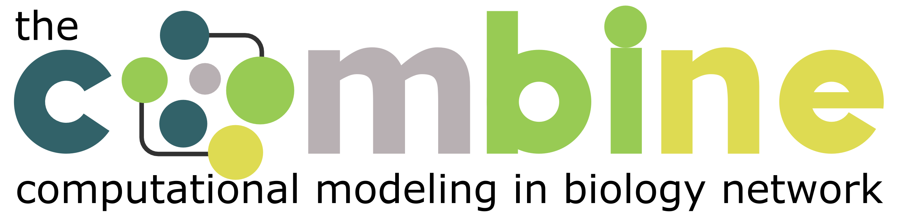

 

The "**Computational Modeling in Biology**" Network (**COMBINE**) is an initiative to coordinate the development of the various community standards and formats in systems biology, synthetic biology and related fields. HARMONY is a codefest-type meeting, with a focus on development of the standards, interoperability and infrastructure. There are generally not many general discussions or oral presentations during HARMONY; instead, the time is devoted to allowing hands-on hacking and interaction between people focused on practical development of software and standards.

HARMONY 2027 will be held at Worcester Polytechnic Institute (WPI) in Worcester, Massachusetts, USA, from 8 to 12 March 2027.

Local organizers are <a href="https://www.wpi.edu/people/faculty/emyoung">Eric M. Young</a> and colleagues at WPI.

## Workshop Location

The building and rooms at WPI will be announced soon.

## Arrival and Transportation

Most international attendees will fly into Boston Logan International Airport (BOS). Worcester is about an hour west of Boston by car. The MBTA Commuter Rail (Framingham/Worcester Line) runs from Boston South Station to Worcester Union Station.

More detailed travel information will be posted here soon.

## Accommodation

Recommended hotels will be posted here soon.

## Meals

Information on meals will be posted here soon.

## Power outlet

The USA uses Type A and Type B plugs (two flat pins, with a round earth pin on Type B) at 120V. Attendees from most other countries will need a plug adapter, and should check that their devices accept 120V.
