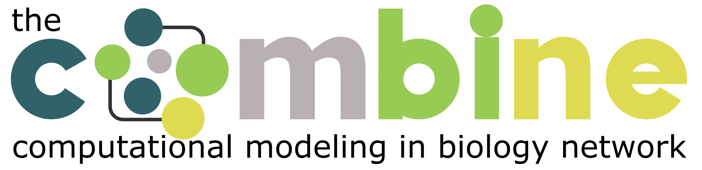

 

The "**Computational Modeling in Biology**" Network (**COMBINE**) is an initiative to coordinate the development of the various community standards and formats in systems biology, synthetic biology and related fields. HARMONY is a codefest-type meeting, with a focus on development of the standards, interoperability and infrastructure. There are generally not many general discussions or oral presentations during HARMONY; instead, the time is devoted to allowing hands-on hacking and interaction between people focused on practical development of software and standards.

HARMONY 2027 will be held at WPI in Worcester, MA, USA from March 8 - 12.

Local organizers are <a href="https://www.wpi.edu/people/faculty/emyoung">Eric M. Young</a> and colleagues.

<!-- ## Power outlet

Type I plugs are used in New Zealand, featuring three flat pins arranged in a triangular pattern. They operate on a voltage of 230V and are designed to ensure safety with an earth pin for grounding. 

[Plugs used in New Zealand (Wikipedia).](https://en.wikipedia.org/wiki/AS/NZS_3112)

 -->

<!-- # Attendees

 -->
